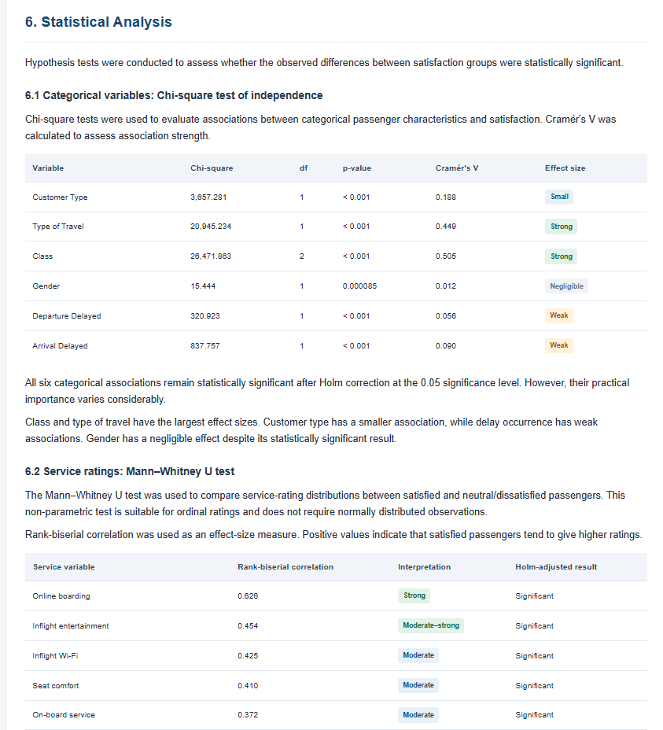
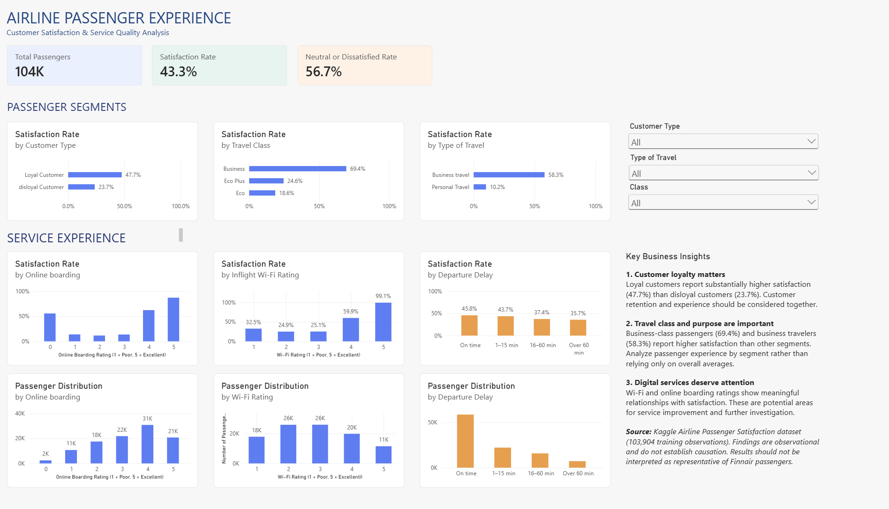

# Airline Passenger Satisfaction Analysis

## Overview

An end-to-end data science project investigating airline passenger satisfaction, identifying key drivers of dissatisfaction, and developing data-driven recommendations for service improvement.

The project combines exploratory data analysis, statistical testing, predictive modelling, and business intelligence to examine passenger experiences and satisfaction patterns.

## Business Objectives

- Understand passenger satisfaction patterns.
- Identify service attributes associated with satisfaction and dissatisfaction.
- Investigate differences between passenger segments.
- Predict passenger satisfaction using machine learning.
- Translate analytical findings into actionable business insights.

## Project Stages

### 1. Data Understanding & Exploratory Analysis

- Data inspection, cleaning, and preprocessing.
- Exploratory analysis of passenger demographics, travel characteristics, service ratings, and flight delays.
- Statistical testing to evaluate differences between passenger segments and satisfaction groups.
- Assessment of effect sizes to distinguish practically meaningful relationships from statistical significance.

A more detailed report can be found in `reports/stage_1_analysis.html`

### 2. Predictive Modelling & Model Interpretation

- Development of Logistic Regression and Random Forest classifiers.
- Comparison of models using different feature sets.
- Evaluation using accuracy, ROC-AUC, and macro F1-score.
- Interpretation using permutation feature importance.

**Best model:** Regularized Random Forest (Model B)

| Metric | Test Performance |
|---|---:|
| Accuracy | 95.95% |
| ROC-AUC | 0.9936 |
| Macro F1-score | 0.9588 |

Model B incorporates service ratings collected after the passenger experience. Its performance therefore reflects classification using experience-related information, rather than purely pre-flight prediction.

A more detailed report can be found in `reports/stage_1_analysis.html`

### 3. Business Intelligence & Recommendations

- Development of an interactive Power BI dashboard.
- Analysis of satisfaction across passenger segments, travel classes, and travel purposes.
- Exploration of service-rating distributions and their relationship with satisfaction.
- Investigation of departure-delay patterns.
- Communication of key findings and potential areas for service improvement.

Final Power BI Dashboard can be found in `dashboard/Final_Dashboard.pbix`

## Key Findings

- Customer type and travel class showed some of the strongest associations with passenger satisfaction.
- Online boarding, inflight entertainment, Wi-Fi, and seat comfort ratings showed substantial differences between satisfied and dissatisfied passengers.
- Flight delays had comparatively weak associations with satisfaction.
- Satisfaction varied considerably across travel purposes and passenger segments.

## Technology Stack

- Python
- Pandas, NumPy
- Matplotlib, Seaborn
- SciPy, Statsmodels
- Scikit-learn
- Power BI

## Dataset

Airline Passenger Satisfaction dataset from Kaggle:

[Airline Passenger Satisfaction – Kaggle](https://www.kaggle.com/datasets/teejmahal20/airline-passenger-satisfaction)

- Training observations: 103,904
- Test observations: 25,976
- Target variable: Passenger satisfaction

## Limitations

- The dataset is publicly available Kaggle data and does not represent any specific airline's customers or operations.
- The analysis is observational; identified relationships should not be interpreted as causal.
- Model B includes post-experience service ratings, limiting its use for predicting satisfaction before a flight.
- Model performance on this dataset may not generalize to other airlines or passenger populations.

## Project Status

Completed.